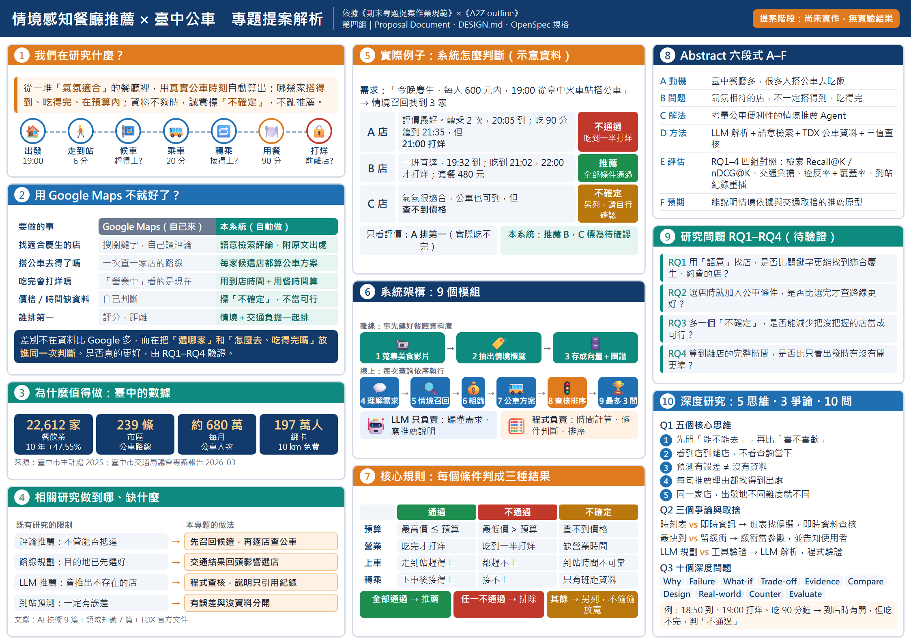

# DIC3：Project Proposal Refactor using OpenSpec

**專題：考量臺中公車交通便利性的情境感知餐廳推薦 AI Agent**
（Context-Aware Restaurant Recommendation with Taichung Bus Accessibility）

> 提案階段，尚未實作，沒有實驗結果。文中所有成效都是預期成果。

## 摘要（約 300 字）

臺中市 2024 年底已有 22,612 家餐飲業，市區公車每月載運約 680 萬人次 [1][2]。然而，評論中「氣氛適合慶生」的餐廳，不一定搭得到公車，也不一定能在打烊前吃完。現有的評論推薦不考慮如何抵達，路線規劃則在目的地選定後才計算；Google Maps 等地圖服務也要使用者逐店查路線、自行推算時間。

本研究提出考量臺中公車便利性的情境感知餐廳推薦 AI Agent：
- 先以語意檢索召回情境相符的候選餐廳。
- 再透過交通部 TDX，為每家店計算步行、候車、乘車、轉乘與用餐的完整時間線。
- 以通過、不通過、不確定三值查核預算、營業與搭乘條件。

LLM 只負責理解需求與撰寫說明，判斷由程式完成，資料不足時明確標示「不確定」。評估規劃以 RQ1–RQ4 對應四組對照：檢索 Recall@K／nDCG@K、交通負擔、違反率與覆蓋率，以及到站紀錄重播。預期產出一個能說明情境依據與交通取捨的推薦原型。

## 資訊圖表（A4 橫式）



原始檔：[infographic.html](infographic.html)（1123×794 CSS px，以 2 倍解析度輸出 PNG）

## 作業項目對照

| # | 作業要求 | 在本 repo 的位置 |
|---|---|---|
| 1 | Install OpenSpec，熟悉 spec-driven development | [`openspec/`](openspec/)；做法見下方〈OpenSpec 工作流程〉 |
| 2 | 釐清 A–F、5 核心、3 取捨、10 細節 | 本頁下方各節；完整摘要見 [refactor/abstract.md](refactor/abstract.md) |
| 3 | 把 design.md 轉成 OpenSpec workflow | [`openspec/changes/add-context-first-restaurant-recommendation/`](openspec/changes/add-context-first-restaurant-recommendation/)；來源為 [DESIGN.md](DESIGN.md) |
| 4 | Introduction refactor | [refactor/introduction.md](refactor/introduction.md) |
| 5 | Related work refactor | [refactor/related-work.md](refactor/related-work.md) |

參考資料與原始連結：[sources.md](sources.md)

## A–F：Abstract 六段式

| | 規範 | 本專題 |
|---|---|---|
| **A** Attention | 問題為何重要 | 臺中 22,612 家餐飲業、公車每月約 680 萬人次；聚餐選店要符合情境，也要到得了 [1][2] |
| **B** But | 現有方法的限制 | 評論語意相符 ≠ 交通方便；選完餐廳才附路線，交通無法影響選店；地圖服務要使用者逐店查詢 |
| **C** Cure | 提出的 AI Agent | 考量臺中公車便利性的情境感知餐廳推薦 AI Agent：先情境召回，再算公車方案，最後篩選排序 |
| **D** Development | 方法 | LLM 解析需求 → BM25／向量／混合檢索 → 知識圖譜保存來源片段 → TDX 公車資料 → 完整時間線 → 三值（T／F／U）查核 → 依判定紀錄產生說明 |
| **E** Experiments | 評估規劃 | RQ1–RQ4 四組對照：檢索 Recall@K／nDCG@K；交通負擔與情境相關性；違反率＋覆蓋率；TDX 到站紀錄重播（**本次補上**） |
| **F** Findings | 預期產出（不虛構結果） | 能說明情境依據與交通取捨的推薦原型；尚無實驗結果 |

## 5 個核心思維模式（Q1）

| # | 核心思維 | 一句話 | 影響的系統設計 |
|---|---|---|---|
| 1 | 必要限制與偏好效用分離 | 先問「能不能去」，再比「喜不喜歡」 | 程式先判 T／F／U，只對全 T 方案算分；語意分數不能抵銷超出預算 |
| 2 | 交通與營業條件的時間相依性 | 看的是到店到離店，不是查詢當下 | 建立出發 → 上車 → 轉乘 → 抵達 → 離店的完整時間線 |
| 3 | 預測不確定性 ≠ 證據不足 | 到站時間有誤差，和沒有資料是兩回事 | U 表示證據不足，不是機率；緩衝作為版本化參數 |
| 4 | 推薦推論的證據可追溯性 | 每句推薦理由都找得到出處 | 保存來源與時間欄位；說明不符紀錄時改用模板 |
| 5 | 目的地選擇與交通方案相依 | 同一家店，出發地不同難度就不同 | 先召回情境候選，再逐店取得路線；每店保留最佳方案 |

## 3 個專業爭論與取捨（Q2）

| # | 觀點 A ↔ 觀點 B | 本專題的取捨 | 尚未解決 |
|---|---|---|---|
| 1 | 時刻表規劃 ↔ 持續使用即時資訊 | 班表與旅運規劃找候選，可取得即時資料的範圍內再查核 | 真實延誤下的效果；臺中資料的更新間隔 |
| 2 | 最早抵達 ↔ 保留可靠性緩衝 | 緩衝作為版本化參數，並在輸出揭露 | 固定緩衝不適用所有路線，需實測資料 |
| 3 | LLM 持續規劃 ↔ 形式化工具驗證 | LLM 只整理輸入與寫說明，程式建立時間線與查核 | 需求解析錯了，後續程式仍會驗證錯的條件；以補問緩解 |

## 10 個深度理解問題（Q3）

| # | 類型 | 問題 | 應能推理的重點 |
|---|---|---|---|
| 1 | Why | 為何營業查核要用抵達與離店時間，而不是查詢時間？ | 候車與轉乘會改變後續時間，要覆蓋整段用餐區間 |
| 2 | Failure case | 18:50 到、19:00 打烊、用餐 90 分鐘，怎麼判？ | 到店時有開仍不夠，吃完超過打烊 → F |
| 3 | What-if | 公車 3 分鐘後到站、走到站要 6 分鐘、且是末班，能推薦嗎？ | 有到站時間 ≠ 搭得上，要比準備時間與班次 |
| 4 | Trade-off | 加大轉乘緩衝後錯誤減少，但能回答的查詢大降，算改善嗎？ | 風險與覆蓋率要一起報告 |
| 5 | Evidence | 兩個來源的營業時間不同，依什麼決定？ | 來源、適用日期、核對時間、版本 |
| 6 | Comparison | TDX 與另一服務的到站時間不同，怎麼判誰準？ | 對齊站位、方向、班次、觀測時點，另取實際到站紀錄 |
| 7 | Design decision | 圖譜與 SQL 存相同事實時，圖譜還有什麼價值？ | 證據路徑、查詢正確性、延遲與維護成本；不能預設推薦更好 |
| 8 | Real-world | 已上車後轉乘取消，為何不能用原出發地重新規劃？ | 要用目前行程狀態與可下車站；屬後續動態擴充 |
| 9 | Counterexample | 所有查詢都不回傳方案，違反率很低，代表可靠嗎？ | 分母為零不能算零錯誤，要看拒答與覆蓋率 |
| 10 | Evaluation | 只重播到站紀錄，能證明實際少錯過公車嗎？ | 只能驗證處理流程；實際效果需額外證據 |

## OpenSpec 工作流程（design.md → spec-driven）

### 安裝與驗證

```bash
npm install -g @fission-ai/openspec
openspec list
openspec validate add-context-first-restaurant-recommendation --strict
```

目前驗證結果：`Change 'add-context-first-restaurant-recommendation' is valid`。

### 轉換方式

原本所有系統設計都寫在一份 [DESIGN.md](DESIGN.md)。轉成 OpenSpec 後，拆成一個 change 的四種 artifact：

```
DESIGN.md ──► proposal.md ──► specs/（8 個 capability）──► design.md ──► tasks.md
              為什麼要做      系統「必須」做到什麼          怎麼做、為何這樣選   實作步驟
```

| DESIGN.md 章節 | OpenSpec capability（`specs/<name>/spec.md`） | 對應模組 |
|---|---|---|
| 需求理解與規劃器 | `query-understanding` | 4 |
| 資料蒐集、抽取與實體對應 | `corpus-ingestion` | 1、2 |
| 評論語意召回 | `context-retrieval` | 5 |
| 公車交通分析與時間線 | `bus-timeline` | 7 |
| 三值查核 | `constraint-checking` | 6、8 |
| 篩選與排序 | `restaurant-ranking` | 8 |
| 輸出與互動 | `recommendation-output` | 9 |
| 資料儲存與來源追溯 | `evidence-provenance` | 3 |

每個 spec 用 `Requirement`（SHALL／MUST）加上 `Scenario`（WHEN／THEN）寫成可驗證的規格。例如 [`constraint-checking`](openspec/changes/add-context-first-restaurant-recommendation/specs/constraint-checking/spec.md) 的兩個情境：

```markdown
#### Scenario: 用餐超過打烊
- **WHEN** 預估 18:50 抵達、19:00 打烊、用餐需 90 分鐘
- **THEN** 營業條件為 F

#### Scenario: 有 U 無 F
- **WHEN** 預算為 T、營業為 U、步行為 T
- **THEN** 組合狀態為 U，列入暫定區
```

### 設計決策的狀態

- 已確認的決策（D002、D005、D007–D009、D014–D017 等）寫進 `design.md` 的 Decisions 表，並落實到 spec。
- **D018**（旅運規劃禁止計程車路段）和 **D019**（摘要補 E 段）仍是「提議」，只記錄在 DESIGN.md，沒有寫進 spec。

## 本次重構了什麼

| 項目 | 原提案 | 重構後 |
|---|---|---|
| Abstract | 沒有 E 段 | 補上 E：RQ1–RQ4 四組對照與指標 |
| Introduction 數據 | 只有餐飲業家數 | 加上 2026 年臺中公車路線、運量、雙十公車綁卡人數 [2] |
| Introduction 結構 | 依原章節 | 依規範 A–F：動機、背景、問題、限制、創新、RQ 與貢獻 |
| 「用 Google Maps 不就好了？」 | 沒有回答 | 新增比較表與示意例子 |
| Related Work 文獻 | 12 篇，2025 年較少 | 新增 3 篇 2025 年文獻（GA-LLM、RecLM、Stockholm 公車可及性）[12][13][20] |
| Related Work 歸納 | 只有文獻表 | 新增「方法比較」與「現有研究 → 限制 → 缺口 → 本研究」兩張表 |
| 設計文件 | 單一 DESIGN.md | DESIGN.md + OpenSpec change（8 個 capability spec） |

## Repo 結構

```
.
├── README.md              ← 本頁：摘要、A–F、5／3／10、OpenSpec 說明
├── infographic.png        ← 資訊圖表（A4 橫式）
├── infographic.html       ← 資訊圖表原始檔
├── DESIGN.md              ← 系統設計與決策紀錄（OpenSpec 的來源）
├── openspec/              ← OpenSpec 設定與 change
├── refactor/
│   ├── abstract.md        ← 中英文摘要（A–F，含 E 段）
│   ├── introduction.md    ← 第一章重構
│   └── related-work.md    ← 第二章重構
└── sources.md             ← 參考資料與原始連結
```
